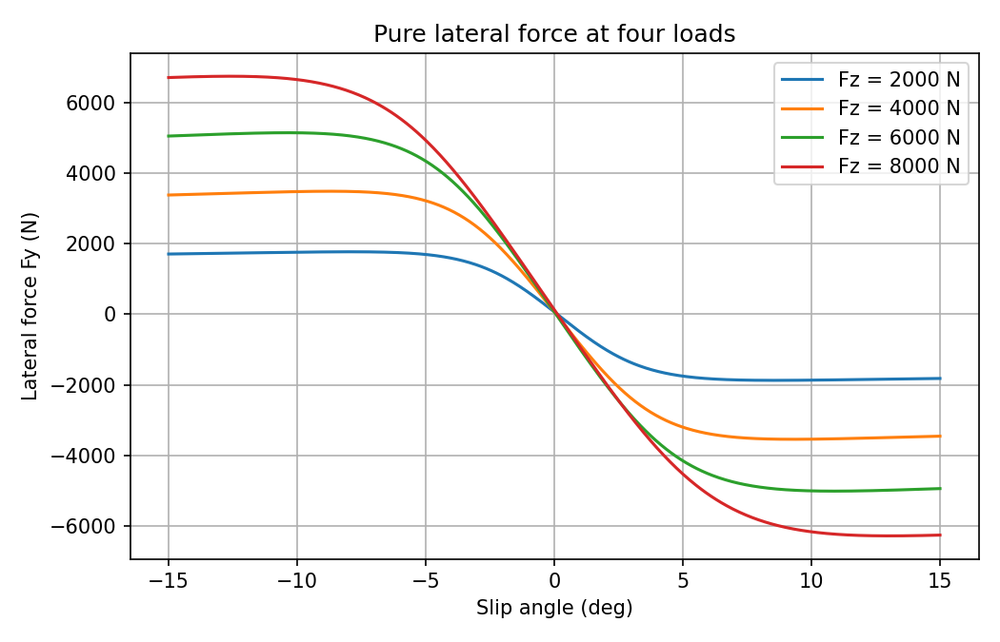
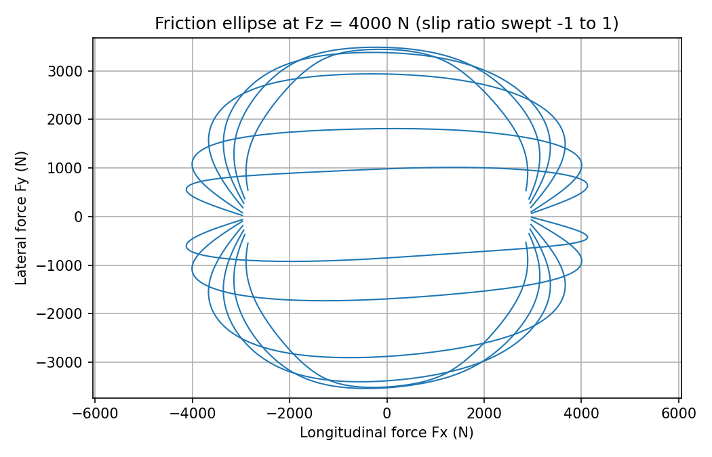
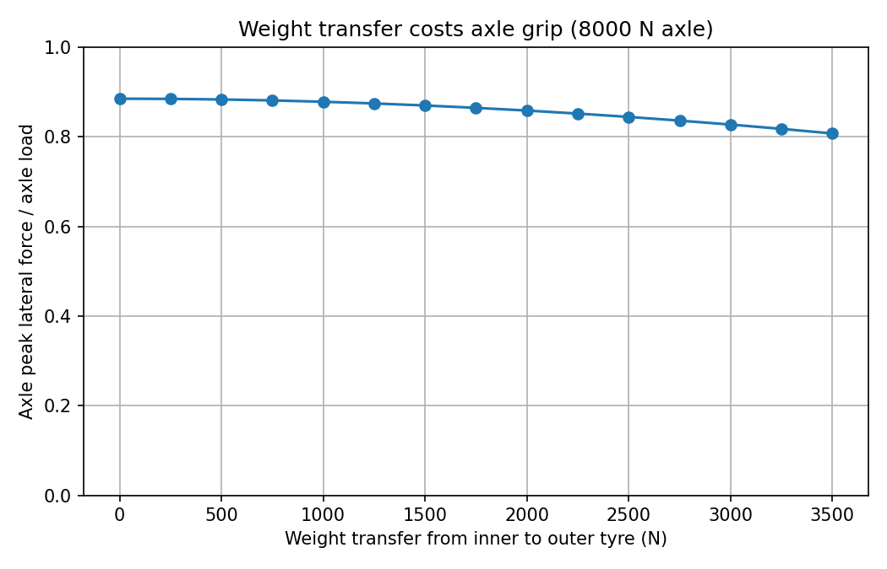

# MF 6.1 tyre model in Python

A from-scratch Python implementation of the Pacejka Magic Formula 6.1 tyre model, validated against an independent MF 6.1 implementation and used for vehicle balance and braking studies.

## What it does

- Reads standard `.tir` tyre property files
- Computes longitudinal force Fx, lateral force Fy and aligning moment Mz
- Covers pure and combined slip, camber, load sensitivity, braking-induced side force and pneumatic trail
- Uses the model for axle weight transfer, front/rear balance, maximum lateral acceleration and optimal braking slip

## Validation

The model was compared point by point with an independent open-source MF 6.1 library over 1980 combinations of slip angle (-15 to 15 deg), slip ratio (-1 to 1), load (2000 to 8000 N) and camber (-4 to 4 deg).

| Output | Largest difference | Cause |
| --- | --- | --- |
| Fx, pure and combined | < 0.001 N | None: identical |
| Fy, pure and combined | 16 N | Reference uses alpha instead of tan(alpha) in pure Fy only |
| Mz, pure and combined | 3 N m | Two small bookkeeping differences in the reference |

Each remaining difference was traced to its cause and shown to vanish when the conventions are matched. The validation also caught a real error in how camber entered Mz (35 N m), which was then fixed. The comparison runs automatically as part of the test suite.

This is validation against another implementation, not against measured tyre data.

## Results



Grip grows with load but less than in proportion: peak lateral force per newton of load falls from 0.91 at 2000 N to 0.81 at 8000 N.



Braking or driving reduces the lateral force available, and a locked wheel keeps only about 6% of it.



Weight transfer in a corner costs axle grip (about 9% at 3500 N on an 8000 N axle), which is why roll stiffness distribution sets a car's balance. Other findings from the notebooks:

- A balanced car reaches 0.851 g against 0.838 g with 60% of the weight transfer at the front
- The best braking slip is about 12% at every load; a locked wheel keeps only about 72% of peak braking force

## Getting started

```
pip install -r requirements.txt
pytest
python make_figures.py
```

The notebooks in `notebooks/` walk through each step, from reading the `.tir` file to the vehicle studies.

## Project structure

| Path | Contents |
| --- | --- |
| `tir_reader.py` | Reads a `.tir` file into a dictionary by section |
| `tyre_model.py` | MF 6.1 forces and moment |
| `vehicle.py` | Axle force with weight transfer, balance, maximum lateral acceleration |
| `tests/` | Validation against the reference, known values and physical behaviour |
| `notebooks/` | Step-by-step development and studies |
| `data/` | Tyre file and reference outputs |
| `figures/` | Plots generated by `make_figures.py` |

## Conventions and assumptions

- ISO sign convention: positive slip angle gives negative lateral force
- Slip angle input as tan(alpha), following MF 6.1
- Nominal inflation pressure, so pressure effects are inactive
- Steady state only: no relaxation length or transient effects

## Credits

- `data/sample.tir` is from the [ExternData](https://github.com/modelica-3rdparty/ExternData) project, BSD 2-Clause licence (see `data/LICENSE_sample_tir.txt`). Its header labels the tyre 225/50R17, but its dimensions describe a 205/60R15.
- Reference outputs in `data/mf61_reference.csv` were generated with the [Magic Formula Tyre Library](https://github.com/teasit/magic-formula-tyre-library) run in GNU Octave. No code from that library is included here.
- Model equations follow H. B. Pacejka, *Tire and Vehicle Dynamics*, 3rd edition, Butterworth-Heinemann, 2012.
- This project's own code is released under the MIT licence (see `LICENSE`).


